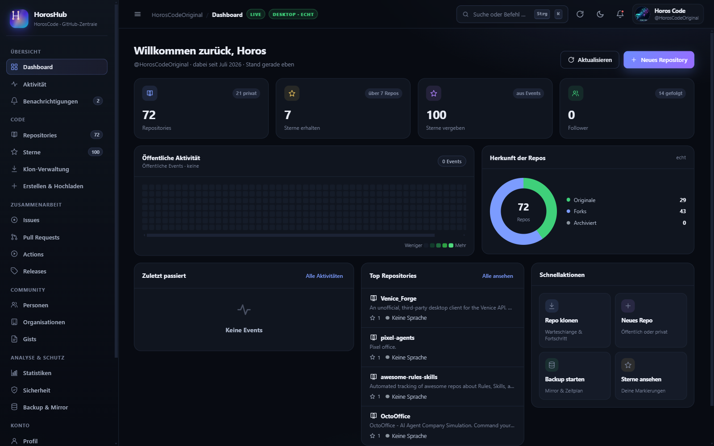
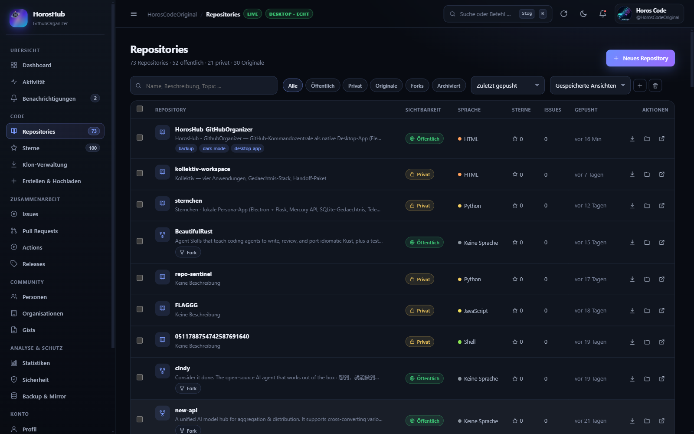
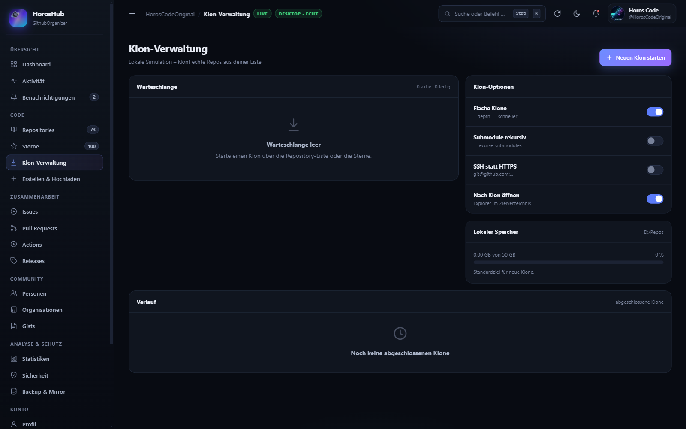
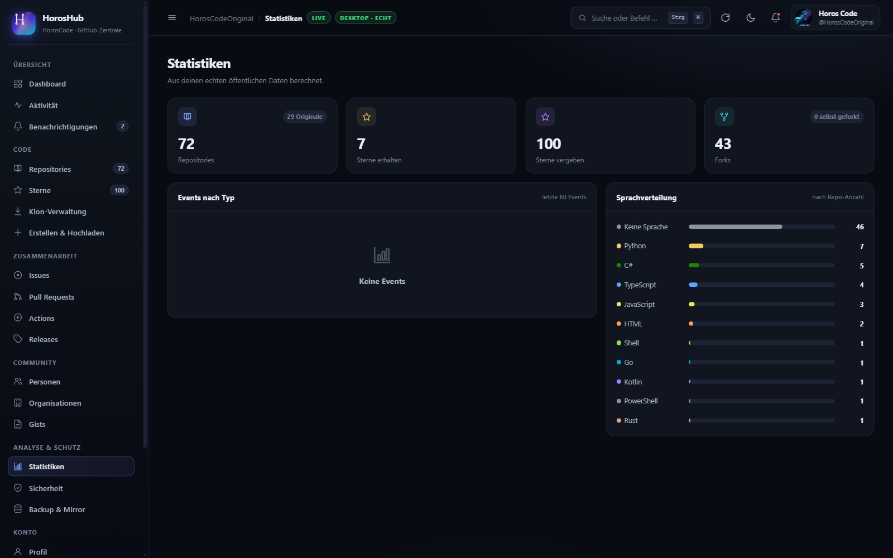
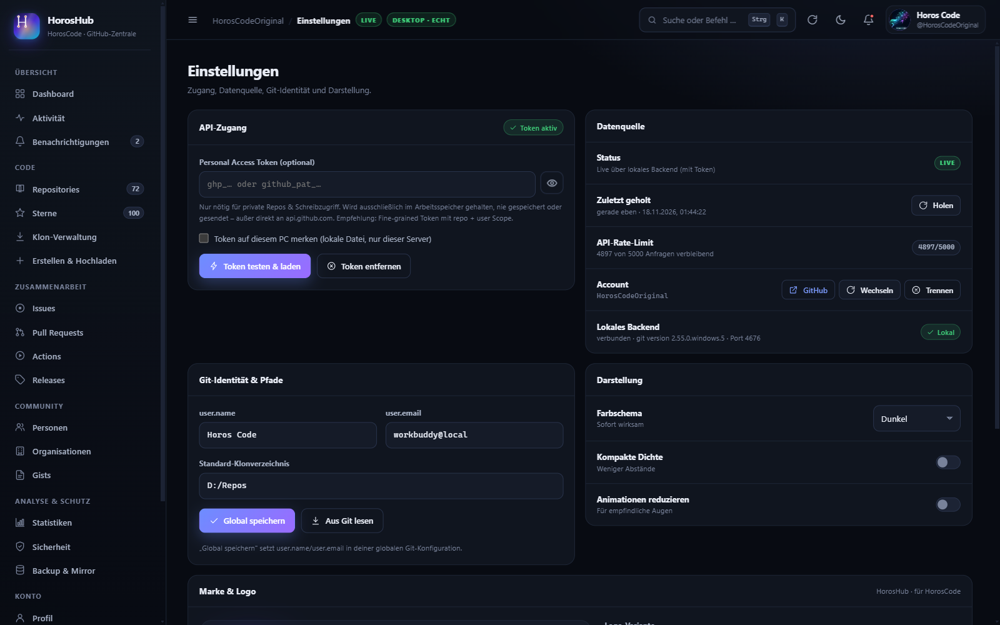
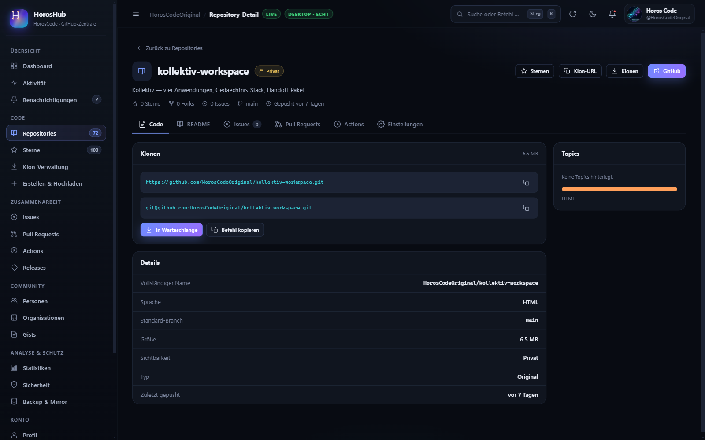
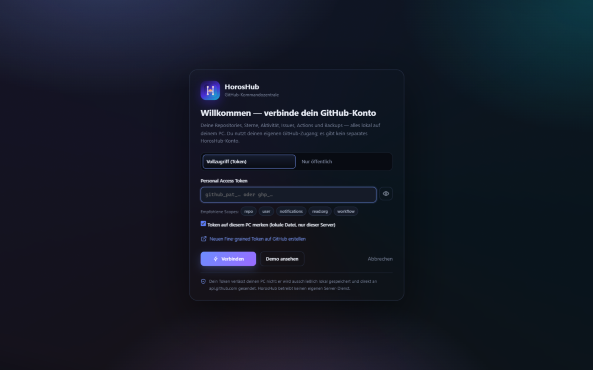

<p align="center">
  
</p>

<h1 align="center">HorosHub - GithubOrganizer</h1>

<p align="center">
  <b>The GitHub command center for your entire account — as a native desktop app.</b><br/>
  Repos · Stars · Activity · Issues · PRs · Actions · Releases · Backup & Mirror · Clone & Upload
</p>

<p align="center">
  <a href="README.md">Deutsch</a> · <a href="README.en.md"><b>English</b></a>
</p>

<p align="center">
  
  
  
  
</p>

<p align="center">
  
</p>

---

## What is HorosHub?

HorosHub manages **your entire GitHub account** in a single, fast desktop window:
every repository (public **and** private), stars, activity, notifications, issues, pull
requests, actions, releases, security alerts, people, organizations, gists and statistics —
plus **real cloning, uploading, mirroring and backups** through your locally installed Git.

There is **no HorosHub account and no HorosHub server**. You connect your own GitHub
access (a Personal Access Token, or public-only via username). All data and your token
stay **on your PC**.

> Multi-tenant: every installation starts with an onboarding flow and connects the
> respective user's account. Nothing is hard-wired to a single account.

## Features

**Overview & analytics**
- Dashboard with live stats, activity heatmap, origin donut (originals / forks / archived), top repos and quick actions
- Statistics view: languages, stars, forks, repo sizes, activity over time
- Profile view with public GitHub data

**Code & collaboration**
- Repository list with search, filters, sorting, saved views and drag-&-drop ordering
- Repository detail with README, topics, clone URLs (HTTPS/SSH) and actions
- Issues & pull requests (close), Actions (re-run / cancel runs), Releases, Dependabot alerts (dismiss)
- Notifications (read / mark-as-read), people (follow / unfollow), organizations, gists (create / delete)

**Real Git operations (local backend)**
- Cloning with progress, queue, cancel, depth (`--depth`) and submodules
- Upload: create a new repo (private / public) from files / folders, real `git push`
- Backup & mirror: scheduled daily backups + weekly mirror update, job history
- Star / unstar, archive, change visibility, delete repo (typed confirmation + undo)

**Desktop experience**
- Native window, tray icon, menu, single-instance, remembered window size
- Native Windows notifications on clone / backup completion
- Native folder opening from the clone history
- Dark / light theme, command palette (`Ctrl+K`), toasts with undo

## Screenshots

| Dashboard | Repositories |
|---|---|
|  |  |

| Clone manager | Statistics |
|---|---|
|  |  |

| Settings | Repository detail |
|---|---|
|  |  |

**First-run onboarding — connect your GitHub account:**



## Installation (for users)

1. Download **`HorosHub-GithubOrganizer-Setup-1.0.0.exe`** from the [GitHub Releases](https://github.com/HorosCodeOriginal/HorosHub-GitHubOrganizer/releases/latest) (alternatively from this repo's `release/` folder).
2. Double-click → install wizard (per-user, target folder selectable).
3. Launch **HorosHub - GithubOrganizer** from the desktop or start-menu shortcut.
4. Connect your GitHub account in the onboarding:
   - **Full access (token):** for private repos + write access. Recommended scopes:
     `repo`, `user`, `notifications`, `read:org`, `workflow` (a fine-grained token with
     repository + account permissions is sufficient).
   - **Public only:** enter a username — loads public repos, profile and activity.
5. Done. Cloning / backups require **Git** (`git --version`); without Git all read / API
   features still work.

**Requirements:** Windows 10/11 (x64). No Node / npm installation needed — the installer
ships the complete runtime.

> ⚠️ The installer is not code-signed. Windows SmartScreen may show a warning on first
> launch ("More info" → "Run anyway"). This is expected for unsigned open-source installers.

> 📦 The setup EXE is ~79 MB. GitHub warns about files >50 MB; for a public repo consider
> **Git LFS** for `release/*.exe` (see below) or attach the installer to a GitHub Release
> as the download source.

## Development / build it yourself

```bash
# Dependencies (Electron + electron-builder)
npm install

# Run the desktop app (develop)
npm start

# Backend + browser only (fallback)
npm run server          # or start-browser.bat

# Build the Windows installer -> release/HorosHub-GithubOrganizer-Setup-1.0.0.exe
npm run dist
```

On Windows, `start.bat` launches the desktop app and `start-browser.bat` the browser
fallback. The backend listens only on `127.0.0.1:4676`.

### Reproduce the screenshots

```bash
npm start -- --remote-debugging-port=9222 --disable-backgrounding-occluded-windows
node build/capture-screens.js screenshots 9222
```

## Architecture

```
index.html          Single-file frontend (vanilla JS, two script layers: base + REAL MODE)
server.js           Zero-dependency Node backend (http, fs, child_process/git, fetch)
desktop/main.js     Electron host: backend autostart, window, tray, menu, single-instance
desktop/preload.js  Safe native bridge (contextIsolation): openPath, notify, …
github-data.js      Embedded demo data (optional demo mode)
build/              Icons (ICO/PNG), icon & shortcut generators, screenshot tool
release/            Finished Windows installer (NSIS)
```

- **Mode detection:** the frontend probes `/api/status`. With a backend = real Git / API
  operations; without one (e.g. `file://`) = public live-read or demo fallback.
- **GitHub access:** through a local proxy `/api/gh/*` (token stays server-side) or directly
  against `api.github.com` in browser mode.
- **Runtime directory:** installed = `%APPDATA%/HorosHub/.horoshub` (token, config, state);
  development = `./.horoshub`. Never part of the repo / installer.
- **Jobs:** clone / upload / backup run as child processes (`git`) with progress parsing,
  cancel and history; a scheduler drives daily / weekly backups.

## Security & privacy

- Your **token never leaves your PC**: it is stored locally (optionally) and sent only
  directly to `api.github.com` or through the local proxy. HorosHub runs no service.
- **No passwords** are used or stored. GitHub has not accepted passwords for the API since
  2021 — use a **Personal Access Token**.
- Token file: `<runtime>/.horoshub/token`. Remove it via Settings → "Remove token" /
  "Disconnect account", or delete the file.
- Recommendation: a **fine-grained token** with minimal permissions and an expiry date.
- Write / delete actions are guarded by confirmation dialogs (some typed) and undo.
- Git identity (`user.name` / `user.email`) is only set globally on explicit click.

## Repository layout

```
.
├── index.html
├── server.js
├── github-data.js / github-data.json
├── package.json / package-lock.json
├── start.bat / start-browser.bat
├── desktop/ (main.js, preload.js)
├── build/ (icon.ico, icon.png, icon-512.png, make-icons.js, make-shortcuts.ps1, capture-screens.js, …)
├── screenshots/ (01–07)
├── release/HorosHub-GithubOrganizer-Setup-1.0.0.exe
├── README.md (German) · README.en.md (English) · LICENSE · .gitignore
```

## Git LFS (optional, for the large EXE)

```bash
git lfs install
git lfs track "release/*.exe"
git add .gitattributes
```

## License

[MIT](LICENSE) — © 2026 HorosCode. GitHub is a trademark of GitHub, Inc.; HorosHub is an
independent open-source tool and is not affiliated with GitHub, Inc.