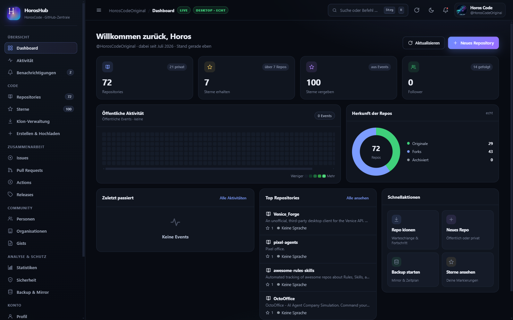
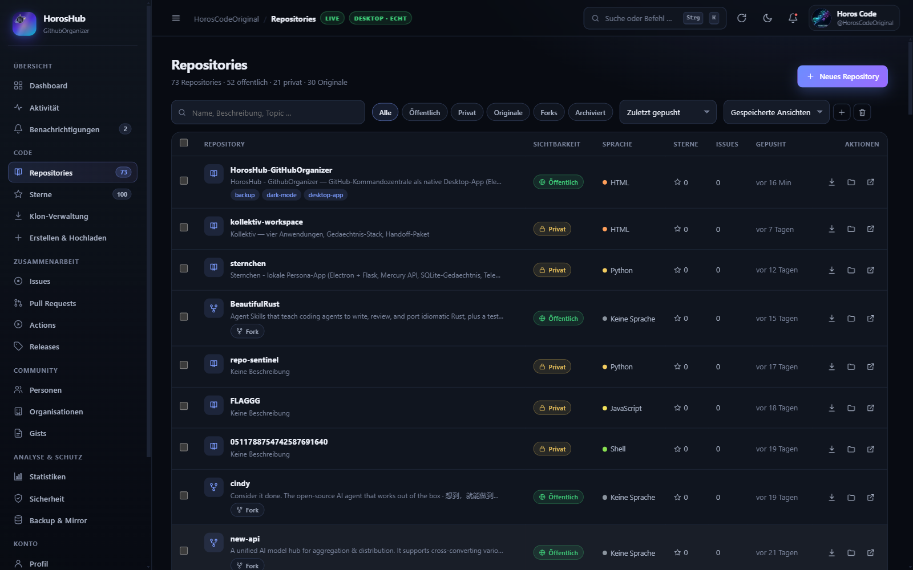
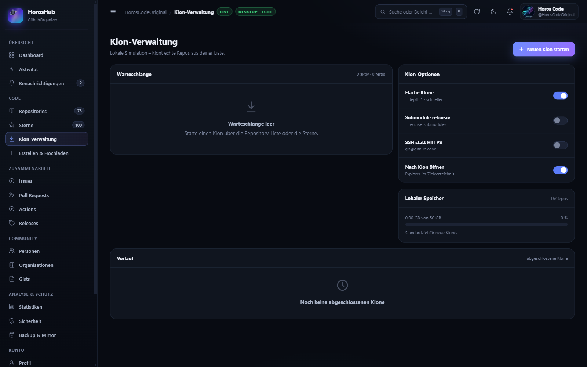
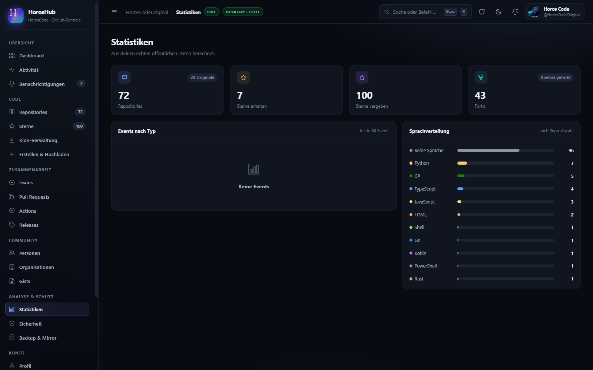
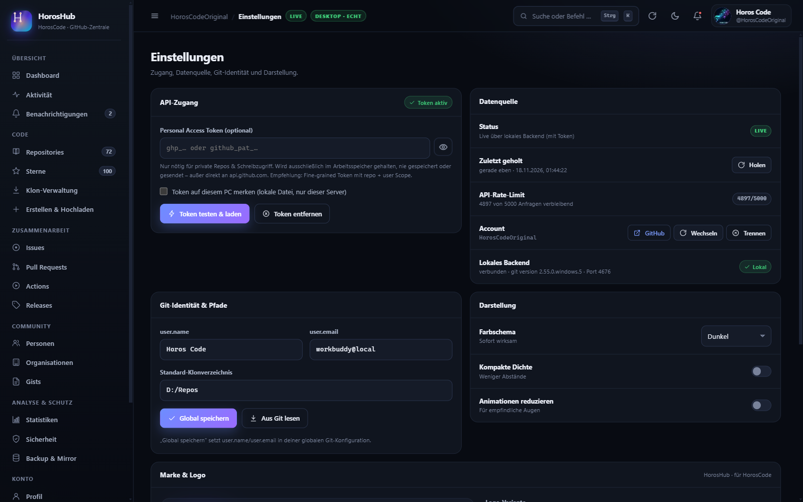
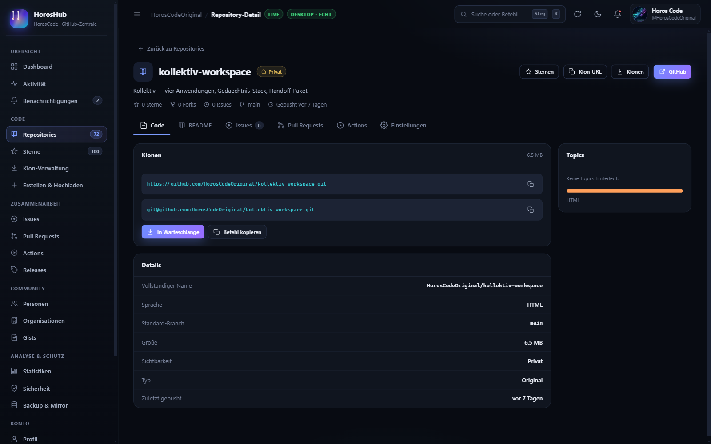
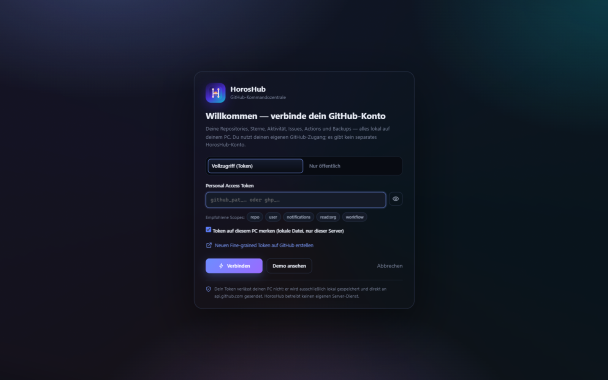

<p align="center">
  
</p>

<h1 align="center">HorosHub</h1>

<p align="center">
  <b>Die GitHub-Kommandozentrale für dein gesamtes Konto — als native Desktop-App.</b><br/>
  Repos · Sterne · Aktivität · Issues · PRs · Actions · Releases · Backup & Mirror · Klonen & Hochladen
</p>

<p align="center">
  
  
  
  
</p>

<p align="center">
  <a href="README.md"><b>Deutsch</b></a> · <a href="README.en.md">English</a>
</p>

<p align="center">
  
</p>

---

## Was ist HorosHub?

HorosHub verwaltet **dein komplettes GitHub-Konto** in einem einzigen, schnellen Desktop-Fenster:
alle Repositories (öffentlich **und** privat), Sterne, Aktivität, Benachrichtigungen, Issues, Pull
Requests, Actions, Releases, Sicherheits-Alerts, Personen, Organisationen, Gists, Statistiken —
plus **echtes Klonen, Hochladen, Spiegeln und Backup** über dein lokal installiertes Git.

Es gibt **kein HorosHub-Konto und keinen HorosHub-Server**. Du verbindest deinen eigenen
GitHub-Zugang (Personal Access Token oder nur öffentlich per Benutzername). Alle Daten und
dein Token bleiben **auf deinem PC**.

> Mandantenfähig: Jede Installation startet mit einem Onboarding und verbindet das Konto des
> jeweiligen Nutzers. Nichts ist fest auf einen Account verdrahtet.

## Features

**Übersicht & Analyse**
- Dashboard mit Live-Statistiken, Aktivitäts-Heatmap, Herkunfts-Donut (Originale/Forks/Archiviert), Top-Repos und Schnellaktionen
- Statistik-Ansicht: Sprachen, Sterne, Forks, Repo-Größen, Aktivitätsverlauf
- Profil-Ansicht mit öffentlichen GitHub-Daten

**Code & Zusammenarbeit**
- Repository-Liste mit Suche, Filter, Sortierung, gespeicherten Ansichten und Drag-&-Drop-Reihenfolge
- Repository-Detail mit README, Topics, Klon-URLs (HTTPS/SSH), Aktionen
- Issues & Pull Requests (schließen), Actions (Runs neu starten/abbrechen), Releases, Dependabot-Alerts (dismissen)
- Benachrichtigungen (lesen/als gelesen markieren), Personen (folgen/entfolgen), Organisationen, Gists (erstellen/löschen)

**Echte Git-Operationen (lokales Backend)**
- Klonen mit Fortschrittsanzeige, Warteschlange, Abbrechen, Tiefe (`--depth`) und Submodulen
- Hochladen: neues Repo (privat/öffentlich) aus Dateien/Ordnern, echtes `git push`
- Backup & Mirror: geplante tägliche Backups + wöchentlicher Mirror-Update, Job-Verlauf
- Sterne setzen/entfernen, Archivieren, Sichtbarkeit ändern, Repo löschen (mit Tipp-Bestätigung + Undo)

**Desktop-Erlebnis**
- Natives Fenster, Tray-Icon, deutsches Menü, Single-Instance, gemerkte Fenstergröße
- Native Windows-Benachrichtigungen bei Klon-/Backup-Abschluss
- Natives Ordner-Öffnen aus der Klon-Historie
- Dark/Light-Theme, Befehlspalette (`Strg+K`), Toasts mit Undo

## Screenshots

| Dashboard | Repositories |
|---|---|
|  |  |

| Klon-Verwaltung | Statistiken |
|---|---|
|  |  |

| Einstellungen | Repository-Detail |
|---|---|
|  |  |

**First-Run-Onboarding — verbinde dein GitHub-Konto:**



## Installation (für Nutzer)

1. Lade **`release/HorosHub-Setup-1.0.0.exe`** herunter (oder aus diesem Repo).
2. Doppelklick → Installations-Assistent (pro Benutzer, Zielordner wählbar).
3. Starte **HorosHub** über die Desktop- oder Startmenü-Verknüpfung.
4. Verbinde im Onboarding dein GitHub-Konto:
   - **Vollzugriff (Token):** für private Repos + Schreibzugriff. Empfohlene Scopes:
     `repo`, `user`, `notifications`, `read:org`, `workflow` (Fine-grained Token genügt mit
     Repository- + Account-Berechtigungen).
   - **Nur öffentlich:** Benutzername eingeben — lädt öffentliche Repos, Profil, Aktivität.
5. Fertig. Für Klonen/Backup wird **Git** benötigt (`git --version`); ohne Git funktionieren
   alle Lese-/API-Funktionen trotzdem.

**Voraussetzungen:** Windows 10/11 (x64). Keine Node-/npm-Installation nötig — der Installer
bringt die komplette Runtime mit.

> ⚠️ Der Installer ist nicht code-signiert. Windows SmartScreen zeigt beim ersten Start ggf.
> eine Warnung („Weitere Informationen“ → „Trotzdem ausführen“). Das ist erwartbar bei
> unsignierten Open-Source-Installern.

> 📦 Die Setup-EXE ist ~79 MB. GitHub warnt bei Dateien >50 MB; für ein öffentliches Repo
> empfiehlt sich **Git LFS** für `release/*.exe` (siehe unten) oder ein GitHub-Release als
> Download-Quelle.

## Entwicklung / Selbst bauen

```bash
# Abhängigkeiten (Electron + electron-builder)
npm install

# Desktop-App starten (entwickeln)
npm start

# Nur Backend + Browser (Fallback)
npm run server          # bzw. start-browser.bat

# Windows-Installer bauen -> release/HorosHub-Setup-1.0.0.exe
npm run dist
```

Unter Windows startet `start.bat` die Desktop-App, `start-browser.bat` den Browser-Fallback.
Das Backend lauscht ausschließlich auf `127.0.0.1:4676`.

### Screenshots reproduizieren

```bash
npm start -- --remote-debugging-port=9222 --disable-backgrounding-occluded-windows
node build/capture-screens.js screenshots 9222
```

## Architektur

```
index.html          Single-File-Frontend (Vanilla JS, zwei Script-Layer: Basis + REAL MODE)
server.js           Zero-Dependency-Node-Backend (http, fs, child_process/git, fetch)
desktop/main.js     Electron-Host: Backend-Autostart, Fenster, Tray, Menü, Single-Instance
desktop/preload.js  Sichere native Bridge (contextIsolation): openPath, notify, …
github-data.js      Eingebettete Demo-Daten (optionaler Demo-Modus)
build/              Icons (ICO/PNG), Icon- & Shortcut-Generatoren, Screenshot-Tool
release/            Fertiger Windows-Installer (NSIS)
```

- **Modus-Erkennung:** Das Frontend prüft `/api/status`. Mit Backend = echte Git-/API-Operationen;
  ohne Backend (z. B. `file://`) = öffentlicher Live-Lesen- bzw. Demo-Fallback.
- **GitHub-Zugriff:** Über einen lokalen Proxy `/api/gh/*` (Token bleibt serverseitig) oder direkt
  `api.github.com` im Browser-Modus.
- **Runtime-Verzeichnis:** installiert = `%APPDATA%/HorosHub/.horoshub` (Token, Config, State);
  Entwicklung = `./.horoshub`. Enthält **niemals** Teil des Repos/Installers.
- **Jobs:** Klon/Upload/Backup laufen als kindprozesse (`git`) mit Fortschritts-Parsing, Abbrechen
  und Verlauf; Scheduler für tägliche/wöchentliche Backups.

## Sicherheit & Privatsphäre

- Dein **Token verlässt deinen PC nicht**: er wird lokal gespeichert (optional) und ausschließlich
  direkt an `api.github.com` bzw. über den lokalen Proxy gesendet. HorosHub betreibt keinen Dienst.
- Es werden **keine Passwörter** verwendet oder gespeichert. GitHub akzeptiert seit 2021 keine
  Passwörter für die API — nutze einen **Personal Access Token**.
- Token-Datei: `<Runtime>/.horoshub/token`. Löschen über Einstellungen → „Token entfernen“ /
  „Account trennen“ oder Datei löschen.
- Empfehlung: **Fine-grained Token** mit minimalen Berechtigungen, Ablaufdatum setzen.
- Schreib-/Löschaktionen sind durch Bestätigungs-Dialoge (teils Tipp-Bestätigung) und Undo geschützt.
- Git-Identität (`user.name`/`user.email`) wird nur auf ausdrücklichen Klick global gesetzt.

## Projektstruktur (Repo)

```
.
├── index.html
├── server.js
├── github-data.js / github-data.json
├── package.json / package-lock.json
├── start.bat / start-browser.bat
├── desktop/ (main.js, preload.js)
├── build/ (icon.ico, icon.png, icon-512.png, make-icons.js, make-shortcuts.ps1, capture-screens.js, …)
├── screenshots/ (01–07)
├── release/HorosHub-Setup-1.0.0.exe
├── README.md (DE) · README.en.md (EN) · LICENSE · .gitignore
```

## Git LFS (optional, für die große EXE)

```bash
git lfs install
git lfs track "release/*.exe"
git add .gitattributes
```

## Lizenz

[MIT](LICENSE) — © 2026 HorosCode. GitHub ist eine Marke von GitHub, Inc.; HorosHub ist ein
unabhängiges Open-Source-Werkzeug und nicht mit GitHub, Inc. verbunden.